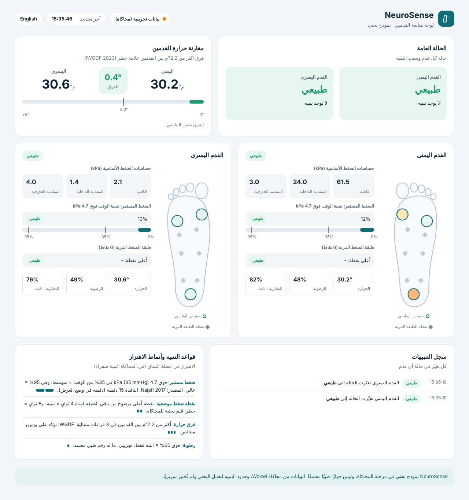

# NeuroSense — Smart Sock Research Prototype (MEDATHON 2026)

**NeuroSense** is a research prototype of a smart sock for people with diabetic peripheral neuropathy. Each sock senses foot pressure and skin temperature. It warns the wearer by vibration on the calf muscle, because sensation there is often still present. Data from both feet go to a cloud database and a live dashboard.

> **This is a research prototype in simulation. It is not an approved medical device.** All sensor values come from a Wokwi simulation. The alert thresholds are research working values and are not clinically validated.

## Live links

| What | Link |
|---|---|
| Dashboard (both feet) | `https://<your-github-username>.github.io/NeuroSense/` |
| Wokwi simulation, right foot | https://wokwi.com/projects/480415315553430529 |
| Wokwi simulation, left foot | `[add the left-foot Wokwi link]` |



## How it works

```
Wokwi simulation (right foot) ─┐
                               ├─> Firebase Realtime Database ─> Web dashboard (index.html)
Wokwi simulation (left foot) ──┘        feet/RIGHT, feet/LEFT        reads both feet every 3 s
```

Each foot uploads its readings every 5 seconds. Each foot also reads the other foot's temperature from the cloud, so the two feet can be compared.

## Sensors per foot (simulation → real product)

| Function | In Wokwi | Intended real part |
|---|---|---|
| Main pressure (heel, inner forefoot, outer forefoot) | 3 potentiometers (GPIO 34, 35, 32) | Thin force sensor, e.g. FSR 402 |
| Flexible pressure layer (6 points) | 6 potentiometers through a CD74HC4067 multiplexer (GPIO 33) | Thin flexible textile pressure layer |
| Skin temperature | DS18B20 (GPIO 4) | Thin NTC thermistor or DS18B20 |
| Humidity (experimental) | DHT22 (GPIO 5) | Smaller sensor, e.g. SHT31 |
| Motion | MPU6050 (I2C 21/22) | MPU6050 or similar IMU |
| Calf vibration | Yellow LED (GPIO 19) | Coin vibration motor with a haptic driver, e.g. DRV2605L |
| Sound alert | Buzzer (GPIO 18) | Buzzer |
| Status light | RGB LED (GPIO 25, 26, 27) | Small LED or app colour |
| Battery level | Potentiometer (GPIO 36) shown on a TM1637 display | Li-Po battery with a fuel gauge, e.g. MAX17048 |
| Local display | SSD1306 OLED | None on the sock; data shown in the dashboard |

## Alert rules

| Alert | Rule in the code | Basis |
|---|---|---|
| Sustained pressure | Above 4.7 kPa (about 35 mmHg) for 35% of a 15-minute window = medium; 95% = high. Demo mode uses a 60-second window. | Najafi et al., 2017 (95% and 35 mmHg); 35% is a team design choice |
| Localized pressure point | One of the 6 layer points is clearly higher than the others for 4 s = alert; 8 s, or very high, = danger | Team simulation values |
| Temperature difference | More than 2.2 °C between the feet on 3 consecutive readings | IWGDF 2023 uses 2.2 °C on two consecutive days; 3 readings is a simulation shortcut |
| Humidity | Above 60% = warning only | Experimental; no medical threshold |

Vibration patterns: medium pressure = one long pulse; high pressure = two long pulses; localized pressure point = fast double pulse; temperature = three short pulses.

## What has been tested and what has not

**Tested (in simulation):** both feet connect to WiFi and upload to Firebase (HTTP 200); each foot reads the other foot's temperature from the cloud; a 5.3 °C difference was counted as consecutive readings above the limit; the localized-pressure rule reached DANGER when one point stayed high; out-of-range temperatures (e.g. 105.6 °C) are rejected as sensor errors.

**Not tested:** real sensors, textile layer, calibration, comfort, washing, battery life, use by people, and any clinical outcome.

## Run it yourself

1. Open each Wokwi link and press the green **Play** button. Run both feet at the same time for the temperature comparison.
2. Open the dashboard link. The top badge shows **Connected to Firebase** when live data arrive, or **Demo data** if the database cannot be reached.
3. Add `?demo` to the dashboard address to see it with demo data only.

## References

1. Bus SA, et al. Guidelines on the prevention of foot ulcers in persons with diabetes (IWGDF 2023 update). *Diabetes Metab Res Rev.* 2024;40(3):e3651. https://doi.org/10.1002/dmrr.3651
2. Najafi B, et al. Smarter Sole Survival: Will Neuropathic Patients at High Risk for Ulceration Use a Smart Insole-Based Foot Protection System? *J Diabetes Sci Technol.* 2017;11(4):702–713. https://doi.org/10.1177/1932296816689105
3. Interlink Electronics. FSR 402 product page and datasheet. https://www.interlinkelectronics.com/fsr-402

## Use of AI

Claude (an AI assistant) helped draft code and text. The team chose the design and checked each source.
